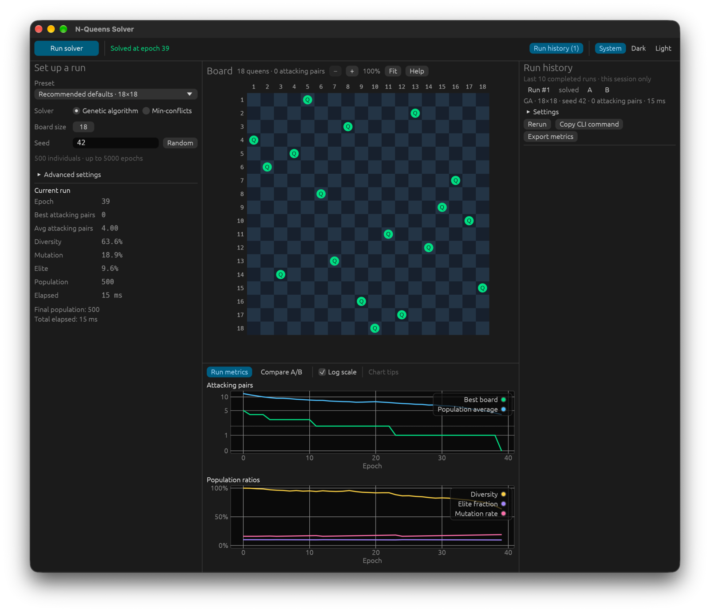

# N-Queens in Rust

A genetic algorithm that places N queens on an N×N board without sharing a row, column, or diagonal. Explore the search in a desktop or browser GUI, run seeded experiments from the command line, or use the Rust library.



*Recommended defaults · 18×18, seed 42: solved at epoch 39. Captured on macOS; runtime varies by machine.*

[Documentation](https://andreashdez.github.io/n_queens_problem_rust/) · [GUI guide](https://andreashdez.github.io/n_queens_problem_rust/gui/) · [CLI reference](https://andreashdez.github.io/n_queens_problem_rust/cli/)

## Get started

You need Git and Rust with Cargo. The repository selects stable Rust through `rust-toolchain.toml`. The GUI also needs a desktop session with a graphics backend. The first build downloads and compiles dependencies.

```bash
git clone https://github.com/andreashdez/n_queens_problem_rust.git
cd n_queens_problem_rust
```

### Desktop GUI

```bash
cargo run --release --locked --features gui --bin n_queens_gui
```

Keep **Recommended defaults · 18×18** and seed **42**, then click **Run solver** to try the example pictured above. Click queens to inspect conflicts, zoom and pan the board, compare runs, and export metrics. Run history lasts for the current session.

To try the GUI without building it, [open it in your browser](https://andreashdez.github.io/n_queens_problem_rust/demo/). It is the same app compiled to WebAssembly, and slower than the desktop app on large boards.

### Command line

```bash
cargo run --release --locked -- --size 18 --seed 42
```

This prints progress, a result summary, and the best board. **Zero conflicts means solved.** `epoch_limit` means the search used its budget without finding a solution; sizes 2 and 3 normally stop immediately as `unsolvable`. Check the stop reason, since unsolved runs still return a successful process exit status; add `--fail-unsolved` to exit with status 1 instead.

Add `--json` for machine-readable output, `--metrics-csv run.csv` to record every epoch, or `--help` for all options. Add `--solver min-conflicts` to compare against a fast min-conflicts local-search baseline. CLI CSV export replaces an existing file at the selected path.

A fixed seed reproduces a run with the same implementation and dependencies. Keep the source revision and lockfile when comparing results.

[Installation and troubleshooting →](https://andreashdez.github.io/n_queens_problem_rust/getting-started/)

## Explore further

| I want to… | Guide |
| --- | --- |
| Inspect boards, compare runs, or export GUI metrics | [GUI guide](https://andreashdez.github.io/n_queens_problem_rust/gui/) |
| Look up flags, defaults, and output formats | [CLI reference](https://andreashdez.github.io/n_queens_problem_rust/cli/) |
| Understand permutations, genetic operators, and conflicts | [How the algorithm works](https://andreashdez.github.io/n_queens_problem_rust/algorithm/) |
| Tune the search or run a parameter sweep | [Tuning guide](https://andreashdez.github.io/n_queens_problem_rust/tuning/) |
| Compare measured configurations and reproduce experiments | [Benchmark report and raw results](benchmarks/README.md) |
| Embed the solver with progress and cancellation | [Rust library guide](https://andreashdez.github.io/n_queens_problem_rust/library/) |

Start with the shipped defaults. Historical benchmark configurations use different settings; the [benchmark report](benchmarks/README.md#choosing-the-defaults) records the change and the evidence behind it.

## Development

```bash
cargo fmt --check
cargo clippy --all-targets --all-features -- -D clippy::pedantic -D clippy::nursery -D warnings
cargo test --all-features
cargo test --all-features --examples
```

The documentation source is in [`website/src/content/docs/`](website/src/content/docs/). See the [development guide](https://andreashdez.github.io/n_queens_problem_rust/development/) for documentation checks, local preview, benchmarks, and publishing.

## License

[MIT](LICENSE)
