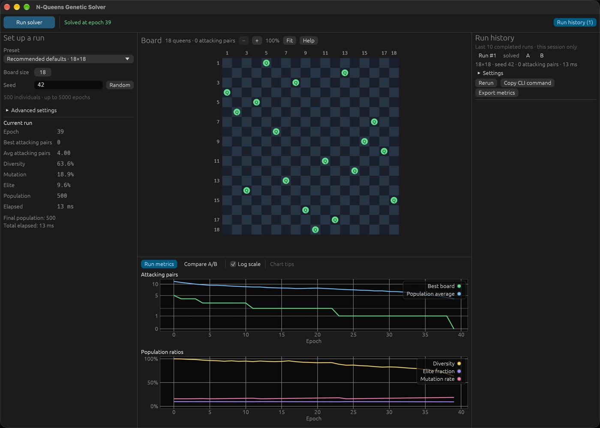

Run the native desktop GUI:

```bash
cargo run --release --locked --features gui --bin n_queens_gui
```

The native GUI runs the solver in the background while you inspect the best board and follow its progress. Settings and current metrics sit on the left, the board in the middle, charts in a resizable panel below it, and run history in a collapsible panel on the right. Start with **Quick demo · 8×8**. A solved run may finish at epoch zero if its initial population already includes a solution.



*Recommended defaults · 18×18, seed 42: solved at epoch 39. Captured on macOS; runtime varies by machine.*

## Configure a run

1. Choose a preset at the top of the controls. **Large board · 5000×5000** shows the solver at scale and usually takes one to two minutes; see [Large boards](../tuning/#large-boards) for how it was tuned.
2. Set the board size and seed. Type any whole number up to 18446744073709551615 as the seed, or click **Random**.
3. Click **Run solver** in the top bar, or press Ctrl/Cmd+Enter, and watch the board and charts.

While a run is going, the top bar shows a progress bar with the current epoch, the epoch budget, and epochs per second; a solution can end the run before the bar fills. **Cancel run** (or Escape) stops after the current epoch. When the run ends, the status next to the button reports the outcome: green when solved, amber when cancelled, out of epochs, or unsolvable.

**Advanced settings** contains population/epoch budgets, mutation, parent selection, diversity, and local-search tuning. Hover over a setting for an explanation. Presets preserve the seed and reset all tuning parameters; manual changes are shown as **Custom settings**.

The GUI follows your system's light or dark mode. Use **System**, **Dark**, or **Light** at the right of the top bar to choose a theme yourself.

The GUI remembers your settings, the theme, the **Log scale** choice, whether run history is shown, and the window and panel sizes between launches. Run history itself is not saved.

## Inspect the board

Each queen shows how many queens attack it, or **Q** when none do, so conflicts are readable without relying on color. Counts are hidden when the board is zoomed too far out for them to fit.

Click a queen to inspect its conflicts: the selected queen gets a white ring, attacking queens get square outlines, and their shared diagonals are highlighted. Coordinates and hover details identify each queen; a text explanation lists the attackers. Click the same queen, an empty square, or **Clear selection** to clear it; Escape also clears it while the board has keyboard focus. Selection follows the chosen column as the best board changes during a run, and resets on a new run. Coordinate labels are sampled on large boards to stay readable.

The compact board toolbar shows the queen and attacking-pair counts alongside the zoom controls. Use **+** / **−**, Ctrl/Cmd + scroll, or pinch to zoom into the board, then drag to pan. **Fit** resets the view, and **Help** opens the selection, navigation, and coordinate instructions. Zoom is anchored at the pointer for scroll/pinch gestures and supports up to 1,024× magnification; drawing and hit-testing follow the visible board region.

## Compare and repeat runs

Toggle the right-hand panel with **Run history** in the top bar, or drag its edge to resize or close it. **Run history** keeps the last ten completed or cancelled runs in memory for this session, including their original settings, seed, outcome, elapsed time, best board, and sampled metrics. Click a run to inspect it, or choose **A** and **B** to overlay their best-conflict curves; picking the second run switches the chart panel to **Compare A/B**. The comparison identifies matching/different seeds and warns when board sizes differ. **Rerun** restores the recorded configuration; **Copy CLI command** copies a reproducible command to run from the project directory.

## Read the charts

The chart panel below the board has two tabs: **Run metrics** for the run on the board and **Compare A/B** for the selected pair. Drag the panel's top edge to give the charts more or less room; the charts grow to fill it.

The GUI counts conflicts as attacking pairs: two queens on the same diagonal are one pair, and a solved board has zero. The **Attacking pairs** chart plots **Best board**, the best board found so far, and **Population average**, which describes the whole current population. These are the CLI's best and average conflicts. The average so it may rise after a restart even while the best score stays unchanged. [See an annotated example](../algorithm/#an-example-of-a-stalled-run).

Hover over charts for the nearest retained sample's epoch and values. Dashed **Soft restart** lines show actual soft-restart epochs. Attacking pairs use a log scale by default so small best-board counts stay readable next to the population average; untick **Log scale** for a linear axis. Population ratios use a fixed 0–100% axis.

Drag a chart to pan along the epochs, zoom with Ctrl/Cmd + scroll or a pinch, and double-click to reset; hover **Chart tips** for a reminder. The attacking-pairs and population-ratio charts share their epoch range. Click a legend entry to hide or show that series.

Each completed run keeps at most 1,024 metric samples, including the first and final epoch, plus the latest 1,024 restart locations. Live updates can skip intermediate events; completed history is collected in the worker independently of GUI refreshes.

## Export a run

**Export metrics** opens your system's save dialog and writes the run to a CSV file. If you pick an existing file, the dialog asks before replacing it. A short confirmation, or the error if writing fails, appears in the top bar. The CSV includes original settings, the stop reason and runtime, `sample` rows with retained metrics, and `restart` rows preserving retained restart locations even where metric samples were thinned. `downsampled` identifies sampled histories; sample rows include the cumulative restart count. Use CLI `--metrics-csv` when you need every epoch rather than the GUI's bounded history. Saved runs are cleared when the app closes.

### Which export should I use?

| | GUI **Export metrics** | CLI `--metrics-csv` |
| --- | --- | --- |
| History | At most 1,024 metric samples | Every epoch, including epoch zero |
| Restart events | Separate `restart` rows, at most 1,024 locations | No separate restart-event rows |
| Row format | `sample` and `restart` records | One metric row per epoch |
| Existing file | Replaces it after the save dialog confirms | Replaces the file |
| Best use | Inspect or compare saved GUI runs | Analyze the full epoch history |

These are different CSV schemas. Check the column headers before combining files.

## Stop a run

Click **Cancel run** or press Escape. Cancellation takes effect at an epoch callback; it may take time to finish the current work. Closing the window also requests cancellation. Completed and cancelled runs remain in history while the app is open.

<details>
<summary>How live updates are retained</summary>

The progress queue holds at most one snapshot. Intermediate updates may be skipped to keep memory bounded; the final result is always delivered. Completed history is sampled in the worker independently of screen refreshes. Unexpected worker disconnection appears as an error.

</details>

[Find settings to try →](../tuning/) · [Understand the metrics →](../algorithm/#reading-the-metrics)
